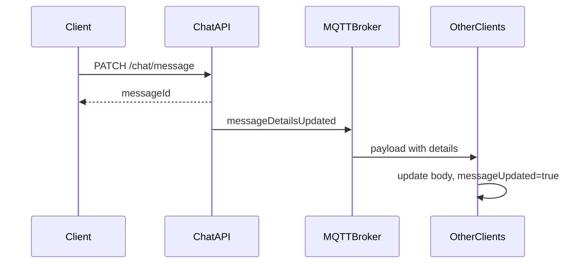

# Edit Message

Cross-platform reference for the **Edit Message** feature. Use this document to implement parity with the Isometrik Chat iOS SDK (Android, web, and other clients).

## Reference implementation (iOS)

When updating this doc, keep it aligned with:

| Concern | Location in repo |
|--------|-------------------|
| HTTP route and headers | `Sources/IsometrikChat/Services/EndPoints/ISMChatMessagesEndPoint.swift` — `editMessage` |
| Text and metadata request bodies | `Sources/IsometrikChat/ViewModel/MessageViewModel/ChatsViewModel+Messages.swift` — `updateMessage`, `updateMessageMetaData` |
| MQTT handling | `Sources/IsometrikChat/MQTT/Manager/ISMChatMQTTManager+MqttDelegate.swift` — `messagedDetailUpdated` |
| UI rules | `Sources/IsometrikChatUI/Views/CustomContextMenu/ISMCustomContextMenu.swift` |

---

## Overview

Edit Message updates an existing message—primarily the **text body**. The same REST endpoint also supports **metadata** updates (for example, link preview enrichment via `customType` and `metaData`).

Typical flow:

1. Client sends `PATCH /chat/message`.
2. API responds with the message identifier.
3. Server publishes an MQTT event with action `messageDetailsUpdated`.
4. All participants update local storage and mark the message as edited (`messageUpdated: true`).



---

## Authentication

Every edit request must include these HTTP headers (same pattern as other chat message APIs):

| Header | Description |
|--------|-------------|
| `userToken` | Token for the logged-in chat user |
| `userSecret` | Project user secret |
| `projectId` | Isometrik project ID |
| `licenseKey` | License key for the project |
| `appSecret` | Application secret |
| `accept` | `application/json` |
| `Content-Type` | `application/json` |

**Base URL:** `https://apis.isometrik.ai` by default. Host apps may override via project `origin` configuration.

The iOS SDK does not call a login endpoint internally; the host application obtains `userToken` and supplies it on each request.

---

## REST API

| Field | Value |
|-------|--------|
| Method | `PATCH` |
| Path | `/chat/message` |
| Full URL | `{origin}/chat/message` |

### Text edit

Used when the user changes message text (iOS: `updateMessage`).

**Request body:**

```json
{
  "messageId": "<message-id>",
  "conversationId": "<conversation-id>",
  "body": "<new text>",
  "searchableTags": ["/@text", "<new text>"]
}
```

**`searchableTags` rules (iOS reference):**

- First tag is always the text type tag: `"/@text"`.
- Second tag is typically the new message body (used for search indexing).

### Metadata / extended edit

Same method and path. The body is a flexible JSON object (iOS: `updateMessageMetaData`). Common fields include:

| Field | Type | Description |
|-------|------|-------------|
| `messageId` | string | Message to update |
| `conversationId` | string | Parent conversation |
| `body` | string | Updated body (optional) |
| `customType` | string | Custom message type (optional) |
| `metaData` | object | Arbitrary metadata (optional) |
| `searchableTags` | string[] | Search tags (optional) |

Use this variant when enriching messages after send (for example, updating `metaData` after a URL is resolved).

### Success response

Shape matches iOS `ISMChatSendMsg`:

```json
{
  "messageId": "<message-id>",
  "msg": "<optional string>",
  "count": 0
}
```

`messageId` and `msg` are optional in decoding; clients should treat a successful HTTP 2xx with a body as confirmation when present.

### Errors

- **401 Unauthorized** — invalid or expired `userToken` or project credentials.
- Other status codes: follow your platform’s standard error handling; the iOS SDK logs failures without a fixed error schema in client code.

### Example: cURL (text edit)

```bash
curl -X PATCH "https://apis.isometrik.ai/chat/message" \
  -H "userToken: <user-token>" \
  -H "userSecret: <user-secret>" \
  -H "projectId: <project-id>" \
  -H "licenseKey: <license-key>" \
  -H "appSecret: <app-secret>" \
  -H "accept: application/json" \
  -H "Content-Type: application/json" \
  -d '{
    "messageId": "msg_abc123",
    "conversationId": "conv_xyz789",
    "body": "Updated message text",
    "searchableTags": ["/@text", "Updated message text"]
  }'
```

---

## Realtime: MQTT `messageDetailsUpdated`

After a successful edit, clients connected via MQTT receive an event whose **action** is `messageDetailsUpdated` (internal enum: `MQTTmessageDetailsUpdated`).

### Payload shape

Decoded on iOS as `ISMChatMessageDelivered`. Important fields:

| Field | Description |
|-------|-------------|
| `action` | `"messageDetailsUpdated"` |
| `messageId` | Affected message ID |
| `conversationId` | Conversation ID |
| `sentAt` | Original send time (epoch ms) |
| `body` | May be present at root level |
| `details` | Object with the updated content |
| `details.body` | New message text |
| `details.searchableTags` | Updated search tags |
| `details.customType` | Updated custom type |
| `details.metaData` | Updated metadata object |

### Example MQTT payload (minimal)

```json
{
  "action": "messageDetailsUpdated",
  "messageId": "msg_abc123",
  "conversationId": "conv_xyz789",
  "sentAt": 1732608000000,
  "details": {
    "body": "Updated message text",
    "searchableTags": ["/@text", "Updated message text"],
    "customType": "TextMessage",
    "metaData": {}
  }
}
```

### Client handling (reference behavior)

1. Find the message by `conversationId` + `messageId`.
2. Apply `details.body` (and `details.metaData` / `details.customType` when present).
3. Set **`messageUpdated`** to `true` on the local message record.
4. If the edited message is the conversation’s last message, refresh the conversation list preview:
   - Use `details.body` for preview text.
   - If `details.metaData.url` is set, iOS may use the URL for preview instead of plain text (`updateLastMessageOnEdit`).

When rendering chat history, iOS treats `action == messageDetailsUpdated` like a normal message update for list filtering but uses `details.body` for the displayed text.

---

## Product rules (UI parity with iOS)

Unless your product team specifies otherwise, match these rules:

| Rule | Behavior |
|------|----------|
| Who can edit | **Sender only** (outgoing messages) |
| Message type | **Text** messages only |
| Deleted messages | Edit hidden if `deletedMessage == true` |
| Broadcast | Edit disabled in broadcast flow |
| Feature flag | Chat features must include **`edit`** |
| Time limit | If **`editMessageForOnly15Mins`** is enabled, editing is allowed only within **15 minutes** of `sentAt` (milliseconds since epoch) |
| Edited indicator | When `messageUpdated == true`, show an edited state in the UI (iOS uses italic “edited” styling) |

---

## Implementation checklist (other SDKs)

1. **Headers** — Attach all required auth headers on every `PATCH /chat/message` call.
2. **Text edit body** — Send `messageId`, `conversationId`, `body`, and `searchableTags` as above.
3. **Local state** — Optionally update UI optimistically; reconcile on API success and MQTT.
4. **MQTT** — Handle `messageDetailsUpdated`; update body, metadata, and `messageUpdated`.
5. **Conversation preview** — Update last-message snippet when the edited message is the latest in the thread.
6. **UI gates** — Enforce sender-only, text-only, feature flag, and optional 15-minute window.
7. **Search** — Keep `searchableTags` in sync with server expectations for text edits.

---

## Related enums and constants

| Name | Value / notes |
|------|----------------|
| `ISMChatActionType.messageDetailsUpdated` | `"messageDetailsUpdated"` |
| Text search tag | `"/@text"` |
| MQTT routing key (iOS) | Payload `action` string `"messageDetailsUpdated"` |

---

## Changelog

| Date | Note |
|------|------|
| 2026-11-26 | Initial cross-SDK doc from iOS Swift Chat SDK reference |

---

## Flutter SDK

| Concern | Location |
|--------|----------|
| Feature flag (opt-in) | `IsmChatFeature.edit` — excluded from default `IsmChatPageProperties.features` (`ismChatDefaultPageFeatures`) |
| Menu gating | `IsmChatMessageModel.canShowEditInFocusMenu` / `focusMenuList` |
| PATCH text edit | `IsmChatPageRepository.editMessageText` |
| Composer | `IsmChatPageEditMessageMixin`, thread `beginEditMessage` |
| MQTT | `IsmChatMqttEventMessageDetailsUpdatedMixin` |
| Chat list preview on reload | `LastMessageDetails.fromMap` resolves `details.body` when root `body` is empty (`messageDetailsUpdated` wire shape); DB recompute in `getConversationsFromDB` |